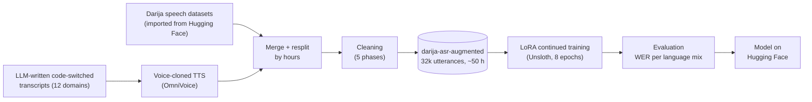

# Darija Whisper ASR

**Speech recognition for Moroccan Darija, including the way Moroccans actually talk: Darija mixed with French and English in the same sentence.**

Whisper large-v3-turbo fine-tuned with LoRA on ~50 hours (32k utterances) of Darija and code-switched speech.
It reaches **6.84% word error rate** on a 484-utterance held-out test set.

| | |
|---|---|
| Model | [`afyfbadreddine77/whisper-large-v3-turbo-darija`](https://huggingface.co/afyfbadreddine77/whisper-large-v3-turbo-darija) on Hugging Face |
| Base model | [`openai/whisper-large-v3-turbo`](https://huggingface.co/openai/whisper-large-v3-turbo) |
| Starting adapter | [`anaszil/whisper-large-v3-turbo-darija`](https://huggingface.co/anaszil/whisper-large-v3-turbo-darija) |
| Real-data collection (next version) | [Smart Darija](https://smart-darija.vercel.app) ([code](https://github.com/badrafyf77/smart-darija)) |

```
Reference:    غادي confirmer معاك لـ rendez-vous غدا
Model output: غادي confirmer معاك لـ rendez-vous غدا
```

Darija is written in Arabic script; French and English words stay in Latin script, exactly as spoken.

---

## Contents

- [Why this project](#why-this-project)
- [Results](#results)
- [Pipeline](#pipeline)
- [Repository structure](#repository-structure)
- [Use the model](#use-the-model)
- [Data](#data)
- [Training](#training)
- [Deployment](#deployment)
- [Limitations and next steps](#limitations-and-next-steps)
- [Credits](#credits)

## Why this project

More than 40 million people speak Moroccan Darija, but off-the-shelf speech recognition handles it badly. Two things make it hard:

1. **Darija is not Modern Standard Arabic.** Its vocabulary, grammar and pronunciation differ, and there is no standard spelling.
2. **Real speech is code-switched.** A typical phone call sounds like *"غادي نصيفط ليك le devis قبل la réunion"*. Models trained on clean single-language data split or "Arabize" the French and English words (*رنديفو* instead of *rendez-vous*).

The goal was a model that transcribes everyday Moroccan speech, such as phone support, appointments and deliveries, with Darija in Arabic script and French/English kept in Latin script.

## Results

Word error rate (WER, lower is better) of the published model:

| Split | Samples | WER |
|---|---:|---:|
| Validation (best checkpoint) | 485 | **6.46%** |
| Test (overall) | 484 | **6.84%** |

Test WER by language mix:

| Language mix | Samples | WER |
|---|---:|---:|
| Pure Darija | 19 | 7.89% |
| Darija + English | 125 | 7.40% |
| Darija + French | 280 | 7.38% |
| Darija + French + English | 60 | 3.51% |

> **About the baseline.** The starting adapter (`anaszil/whisper-large-v3-turbo-darija`) reports **24.88% WER on its own evaluation set**. That set is different from this project's test split, so the two numbers are not a direct before/after comparison. A like-for-like baseline (the starting adapter scored on this test split, using cell 8 of the notebook) is on the to-do list.

## Pipeline



1. **Collect.** Import existing Darija speech datasets from the Hugging Face Hub with the Dataset Studio.
2. **Generate.** Have an LLM write natural code-switched sentences across 12 everyday domains, then turn them into speech with a voice-cloning TTS model.
3. **Clean.** Remove bad samples, filter durations, augment real audio, normalize transcripts and remove duplicates (details in [`docs/data_pipeline.md`](docs/data_pipeline.md)).
4. **Train.** Continue training an existing Darija LoRA adapter on the new dataset with Unsloth.
5. **Evaluate.** Measure WER overall and for each language mix.

## Repository structure

```text
darija-whisper-asr/
├── README.md                     ← you are here
├── docs/
│   └── data_pipeline.md          ← synthetic generation + cleaning, step by step
├── data_studio/                  ← Moroccan ASR Dataset Studio (local web app)
│   ├── viewer_server.py          ← Python backend: viewer, Hub import/merge/push, cleaner, generator jobs
│   ├── index.html, app.js, styles.css
│   ├── tools/
│   │   ├── best_asr_text_normalizer.py   ← Darija + French/English transcript normalizer
│   │   └── prepare_for_viewer.py
│   └── synthetic_cs_dataset/     ← synthetic code-switch data generator
│       ├── configs/generation.yaml
│       ├── prompts/text_generation_prompt.txt
│       └── scripts/              ← generate_texts, generate_audio, augment, validate, make_hf_dataset ...
├── training/
│   ├── README.md                 ← what each script is and how they relate
│   ├── darija_finetune.ipynb     ← final training + evaluation run (produced the published model)
│   └── experiments/
│       ├── modal_hyperparam_search.py   ← Optuna search over AdaLoRA settings (Modal, A100)
│       ├── modal_finetune.py            ← continued-training run on Modal (L4)
│       └── finetune_darija_whisper.py   ← first full run: fresh LoRA r=32 (Lightning AI, L4)
└── data_collection/
    └── prompts/                  ← prompts that generate the sentences volunteers read on Smart Darija
```

## Use the model

```python
from transformers import WhisperForConditionalGeneration, WhisperProcessor
from peft import PeftModel
import torch

processor = WhisperProcessor.from_pretrained("openai/whisper-large-v3-turbo")
base = WhisperForConditionalGeneration.from_pretrained(
    "openai/whisper-large-v3-turbo", torch_dtype=torch.float16
).to("cuda")
model = PeftModel.from_pretrained(base, "afyfbadreddine77/whisper-large-v3-turbo-darija")
model.eval()

# audio_array: 1-D numpy array of 16 kHz mono audio
inputs = processor(audio_array, sampling_rate=16000, return_tensors="pt").input_features.to("cuda", torch.float16)
with torch.no_grad():
    ids = model.generate(inputs, language="arabic", task="transcribe", max_new_tokens=444)
print(processor.decode(ids[0], skip_special_tokens=True))
```

## Data

The training set, `afyfbadreddine77/darija-asr-augmented`, is private. Its structure:

| | |
|---|---|
| Splits | train 32,028 · validation 485 · test 484 utterances |
| Audio | ~50 hours, including augmented copies |
| Mix | ~65% pure Darija, ~35% code-switched |
| Columns | `audio`, `text`, `lang_mix`, `duration`, `is_augmented` |
| `lang_mix` values | `darija`, `darija_french`, `darija_english`, `darija_french_english` |

### Transcript convention

| | Example |
|---|---|
| Good | `اليوم عندي rendez-vous مع le client باش نهضرو على projet.` |
| Bad (Arabized French) | `عندي رنديفو مع الكليان` |
| Bad (no Darija) | `I have a meeting with the client.` |

### Synthetic code-switched speech

Real code-switched recordings are rare, so the [generator](data_studio/synthetic_cs_dataset) creates them:

- **Text:** an LLM (Gemini 3.1 Flash-Lite through an OpenAI-compatible API) writes short phone-call utterances (3–25 words) in batches, with a target language-mix distribution and 12 domains such as phone support, appointment booking, delivery tracking, bank and insurance calls, healthcare and job interviews. The [prompt](data_studio/synthetic_cs_dataset/prompts/text_generation_prompt.txt) enforces the script convention and bans MSA-heavy phrasing and other Arabic dialects.
- **Audio:** [OmniVoice](https://huggingface.co/k2-fsa/OmniVoice) clones 10–30 reference speakers to read the transcripts (24 kHz, 1–25 s clips).
- **Checks:** validation scripts, a review sample, and a cap on how many times the same text can appear.

### Cleaning (Dataset Studio)

The [Dataset Studio](data_studio) is a local web app built for this project. It runs five cleaning phases on any Hugging Face dataset:

| Phase | What it does |
|---|---|
| 1. Bad sample removal | Transcribes each clip with Whisper and drops rows whose character error rate against the label is too high, or whose speaking rate (characters per second) is implausible. |
| 2. Duration filtering | Keeps clips between 1 and 30 seconds (drops anything under 0.7 s). |
| 3. Augmentation | Adds augmented copies of *real* recordings only (the TTS source is excluded): speed 0.9×/1.1×, background noise at a random SNR (office, call center, café, street and home profiles), room reverb, telephone-line degradation and ±6 dB gain. One effect per copy, no pitch shifting. |
| 4. Transcript normalization | [`best_asr_text_normalizer.py`](data_studio/tools/best_asr_text_normalizer.py) keeps Darija in Arabic script and French/English in Latin script, keeps French accents and apostrophes, and strips diacritics, tatweel, emojis, noise tags and letter stretching. |
| 5. Duplicate removal | Drops repeated transcripts after normalizing spaces, case and punctuation. |

Every phase writes a JSON report of what it removed and why. Full details: [`docs/data_pipeline.md`](docs/data_pipeline.md).

## Training

**Strategy: continue, don't restart.** Instead of training a new adapter from scratch, the final run loads an existing community Darija LoRA adapter (r=16) on top of Whisper large-v3-turbo and keeps training it on the new code-switched dataset. The model keeps what the adapter already knew about Darija and learns code-switching on top.

| Parameter | Value |
|---|---|
| Method | LoRA continued training (r=16, alpha=32), Unsloth + Hugging Face Transformers |
| Trainable parameters | 13.9M / 822.8M (1.69%) |
| Epochs | 8 |
| Effective batch size | 32 (16 × gradient accumulation 2) |
| Learning rate | 1e-4, cosine schedule, 200 warmup steps |
| Optimizer | AdamW, weight decay 0.01 |
| Precision | bf16 |
| Checkpoint selection | Best validation WER (evaluated every 500 steps with generation) |
| Hardware / time | NVIDIA RTX PRO 6000 Blackwell (~95 GB VRAM), ~3 h |

Before the final run, an [Optuna hyperparameter search](training/experiments/modal_hyperparam_search.py) on Modal (A100-80GB) explored AdaLoRA ranks, alpha, learning rate and dropout on small language-mix-balanced subsets. [`training/README.md`](training/README.md) explains every script.

To reproduce, open [`training/darija_finetune.ipynb`](training/darija_finetune.ipynb), set your Hugging Face token in cell 2, and run the cells in order. The published run used a ~95 GB GPU; the notebook also needs a high-RAM runtime (~52 GB) because it preprocesses all 32k samples in memory.

## Deployment

For production use, the LoRA adapter is merged into the base model and converted to CTranslate2, so it can run with [faster-whisper](https://github.com/SYSTRAN/faster-whisper). It is served by a FastAPI service with a file-upload endpoint and a WebSocket streaming endpoint. That service lives in a separate private repository.

## Limitations and next steps

- **Test set realism.** The test split comes from the same pipeline as the training data, which includes synthetic TTS speech. Expect higher WER on real, noisy phone calls. A test set of real recorded speech is the next priority.
- **Small slices.** Only 19 test utterances are pure Darija, so that row of the table is a rough estimate.
- **Spelling variation.** Darija has no standard orthography, so WER counts some valid spellings as errors. Character error rate (CER) would complement it.
- **Like-for-like baseline.** Score the starting adapter on this test split to measure the real gain from continued training.
- **Real data.** [Smart Darija](https://smart-darija.vercel.app) is a crowdsourcing site where Moroccans record themselves reading Darija, Darija+French and Darija+English sentences. Its recordings will feed the next model version.

## Running the Dataset Studio

```bash
cd data_studio
pip install -r synthetic_cs_dataset/requirements.txt
python3 viewer_server.py --host 0.0.0.0 --port 8000
# open http://localhost:8000
```

Keep API keys in `data_studio/synthetic_cs_dataset/.env` (copy `.env.example`). `.env` is git-ignored. See [`data_studio/README.md`](data_studio/README.md) for each workflow.

## Credits

- [OpenAI Whisper](https://github.com/openai/whisper): base model
- [anaszil/whisper-large-v3-turbo-darija](https://huggingface.co/anaszil/whisper-large-v3-turbo-darija): starting Darija LoRA adapter
- [Unsloth](https://github.com/unslothai/unsloth), [PEFT](https://github.com/huggingface/peft), [Transformers](https://github.com/huggingface/transformers): training
- [OmniVoice (k2-fsa)](https://huggingface.co/k2-fsa/OmniVoice): voice-cloned TTS for synthetic speech
- The public Darija speech datasets on the Hugging Face Hub that made the real-speech portion possible

## License

Code: [MIT](LICENSE). The model on Hugging Face is also released under MIT.

---

Built by [Afyf Badreddine](https://github.com/badrafyf77), Master's student in Artificial Intelligence, Casablanca.
